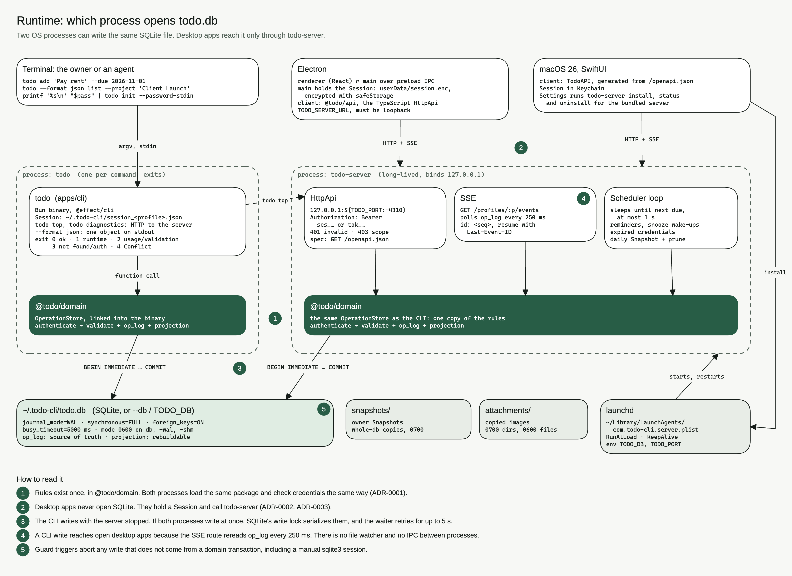

# Todo

Personal, local-first Task tracking for one person. A CLI, a loopback HTTP
server, and Electron and macOS clients share one Effect domain package and one
SQLite file.

The CLI opens that file directly and works with the server stopped. Desktop
clients never open SQLite. They call the authenticated HttpApi and subscribe to
SSE. Agents get the same capabilities as the owner: JSON on stdout, published
schemas, and dry-run on destructive commands.



How the pieces fit, and the data model, are in
[docs/architecture.md](docs/architecture.md). Words such as Profile, Task,
Version, and Purge are defined in [CONTEXT.md](CONTEXT.md).

## Decisions

Todo started as a Go CLI. Moving it to Effect TypeScript and adding two
desktop apps forced these choices. Each row links the record that binds the
code. The [decision log](docs/adr/README.md) tells the full story, including
what was rejected.

| We chose | Instead of | Because | Record |
| --- | --- | --- | --- |
| One Effect domain package for CLI and server | Keeping Go beside a new server | Two writers with copied rules drift | [0001](docs/adr/0001-port-to-effect-with-shared-domain.md) |
| Desktop apps go through the local server | Swift reading SQLite directly | Writes would need a third copy of the rules | [0002](docs/adr/0002-server-is-the-gateway-for-ui-and-remote-clients.md) |
| HttpApi with generated OpenAPI | Effect RPC | Swift can generate a client from OpenAPI | [0003](docs/adr/0003-httpapi-openapi-as-the-single-contract.md) |
| An operation log as source of truth | Triggers filling a change log | History becomes replayable and Conflicts stay visible | [0007](docs/adr/0007-operation-log-is-the-source-of-truth.md) |
| Purge redacts History in place | Deleting log rows | Erases content without holes in `seq` | [0008](docs/adr/0008-purge-redacts-history-content.md) |
| One owner, Profiles, Sessions and Access Tokens | Multiple users | One person, many areas of life, scoped agents | [0005](docs/adr/0005-single-owner-profiles-and-two-credential-kinds.md) |
| RFC 5545 Series with real Occurrence Tasks | A cron scheduler | The chain continues with the server stopped | [0006](docs/adr/0006-time-model-and-rfc5545-recurrence.md) |
| Every capability ships a CLI command and UI in both apps | One audience first | The other path never gets built | [0009](docs/adr/0009-every-capability-is-native-to-agents-and-humans.md) |

[SPEC.md](SPEC.md) records the retired Go v0.1 behavior. Where it disagrees
with a record, the record wins.

## Build and install

Install [Bun](https://bun.sh/) 1.4.4 or newer, Node.js 22.12 or newer, and
pnpm 10.30.1. Bun runs TypeScript and compiles binaries. pnpm manages packages.
From the checkout:

```sh
pnpm install --frozen-lockfile
./scripts/install.sh
```

The script builds `apps/cli/dist/todo` and `apps/server/dist/todo-server` and
installs both in `~/.local/bin`. It does not initialize a database, run
migrations, start a server, or install a LaunchAgent. Add that directory to
PATH:

```sh
export PATH="$HOME/.local/bin:$PATH"
```

Another directory:

```sh
./scripts/install.sh --install-dir /absolute/path/to/bin
```

`make build` compiles both binaries. `make install` compiles and installs.
Override the destination with `make install INSTALL_DIR=/path/to/bin`.

## Use the CLI

The default database is `~/.todo-cli/todo.db`. `--db /absolute/path/to/todo.db`
selects another file. For a new database, configure the owner and sign in:

```sh
printf 'Owner passphrase: '
IFS= read -r -s todo_passphrase
printf '\n'
printf '%s\n' "$todo_passphrase" | todo init --password-stdin
unset todo_passphrase
todo login
todo add 'Pay rent' --priority P1 --due 2026-11-01
todo list
```

Copy a Task ID from the output. Writes need the latest Version, exposed as
`row_version`:

```sh
todo show TASK_ID
todo edit TASK_ID --title 'Pay rent and utilities' --expected-version 1
todo done TASK_ID --expected-version 2
```

A Profile is one area of life, such as work or personal. Select it with
`--profile work`. `todo init --profile work` creates a Profile after owner
setup. Sign in for that Profile with `todo --profile work login`. The owner's
Session lasts seven days with no sliding renewal. Agents can use scoped,
revocable Access Tokens issued through the server API.

```sh
todo --profile work list
todo list --project 'Client Launch' --tag revenue --status open
todo review daily
todo review weekly
todo export --template jira-context
todo sync obsidian --vault /absolute/path/to/vault
todo --format json list
todo man edit
```

Output defaults to Markdown. `--format json` and `--format table` select other
formats. Validation exits 2, authentication and not-found exit 3, and a stale
Version exits 4 and prints the latest Task. `rm` Deletes a Task.
`rm --force` Purges a previously deleted Task. History records accepted and
rejected changes. Revert records the opposite change.

## Run the local server

Provision the selected database with the CLI first. To run in the foreground,
set an explicit database path:

```sh
TODO_DB="$HOME/.todo-cli/todo.db" TODO_PORT=4310 todo-server
```

The server binds to `127.0.0.1`. `TODO_PORT` defaults to 4310.
`GET /health` returns `{"service":"todo-server"}`. The API contract is at
`/openapi.json`. Task routes need a Session or Access Token as a Bearer
credential. See [packages/api/openapi.json](packages/api/openapi.json).

On macOS, manage the launchd user agent with the compiled server:

```sh
TODO_DB="$HOME/.todo-cli/todo.db" TODO_PORT=4310 todo-server install
todo-server status
todo-server uninstall
```

Install requires an absolute `TODO_DB` and records the executable path, so keep
the installed binary in place. Uninstall removes the agent and its plist and
keeps the database and logs. These lifecycle commands require macOS.

## Desktop clients

The [Electron client](apps/electron/README.md) has planning views, quick add,
Task editing, History, conflict resolution, and reminders. Build it with
`pnpm --filter @todo/electron build`. `TODO_SERVER_URL` selects its local
server and defaults to `http://127.0.0.1:4310`.

The [macOS 26 SwiftUI client](apps/macos/README.md) lives in
`apps/macos/Todo.xcodeproj`. It uses a generated Swift HttpApi client and
stores Sessions in Keychain. Settings installs, supervises, and updates its
bundled server.

There are no prebuilt releases yet. Both apps build unsigned by default. To
sign them with your own Apple Development certificate, copy
`signing.example.mk` to `signing.local.mk`, set your identity and team, and run:

```sh
make sign-desktop                # builds into dist/signed.noindex/
scripts/sign-and-install.sh      # builds and installs both apps in /Applications
```

The target checks package age and free disk before building, prints strict
signature checks, and writes `dist/signed.noindex/signing-receipt.json`.
`signing.local.mk` is ignored by Git. Run signing in your own Terminal, since
macOS may ask for your login keychain password.

## Keep an install on one build

The CLI, the server, and both apps must speak the same API. Each binary
carries a build id (the git commit) and a contract id (the sha256 of
[packages/api/openapi.json](packages/api/openapi.json)):

```sh
todo --version          # todo 0.1.0 build=8dcb2930 contract=5835fbd0…
todo-server --version
curl -s http://127.0.0.1:4310/health
```

Both desktop clients compare the server's contract with their own when they
connect, after sign-in, and when live updates reconnect. A mismatch shows
"Todo server is out of date" and the client sends no Task requests until the
server is updated. The server answers query parameters it does not declare
with 400, so an older client cannot silently get unfiltered results either.

To move everything to the checkout's build, quit both apps and run:

```sh
scripts/upgrade-local.sh
```

It backs up `~/.todo-cli/todo.db`, installs the CLI and server, signs and
installs both apps, replaces the managed server with the one bundled in
`Todo.app`, restarts it, and waits for `/health`. If any step fails after the
server stops, it restarts the previous server. On macOS, Settings → Update
server replaces only the managed server and keeps its database and port.

Every installer ends with a headless check that never launches an app:

```sh
scripts/check-installed.sh                          # every installed component must match
scripts/check-installed.sh --require cli,server-bin # these must exist and match
```

It prints one row per component (`cli`, `server-bin`, `managed-server`,
`macos-app`, `electron-app`) with its build and contract. A component that is
not installed is reported, not failed. A required component that is missing or
mismatched exits nonzero; other mismatches print a WARNING naming
`scripts/upgrade-local.sh`. `install.sh` requires the two binaries and
`sign-and-install.sh` requires both apps. Run with `--help` for path overrides.

## Verify a change

```sh
pnpm check
.agents/skills/verify-install/scripts/verify.sh "$PWD/docs/evidence/install/run-1"
```

`pnpm check` typechecks, lints, and runs workspace tests. Each subsystem has a
verification recipe under `.agents/skills/verify-*`. A recipe drives the
compiled binaries against a scratch HOME and scratch SQLite and writes evidence
to a gitignored folder. The install recipe above builds both binaries, then
runs [verify-cli](.agents/skills/verify-cli/SKILL.md) and
[verify-server-api](.agents/skills/verify-server-api/SKILL.md) on them. Coding
agents can run the same recipes as skills.

The five Go integration goldens in
[apps/cli/test/golden](apps/cli/test/golden/) are kept byte for byte and remain
the CLI acceptance spec.

## Docs

| Page | What it is |
| --- | --- |
| [Architecture](docs/architecture.md) | Runtime, packages, writes, data model |
| [Decisions](docs/adr/README.md) | Why the system is shaped this way, and what was rejected |
| [CONTEXT.md](CONTEXT.md) | Domain language |
| [CONTRIBUTING.md](CONTRIBUTING.md) | Development and verification |
| [SECURITY.md](SECURITY.md) | Vulnerability reporting |
| [LICENSE](LICENSE) | MIT |

Workspace packages are private so they are not published to npm by accident.
