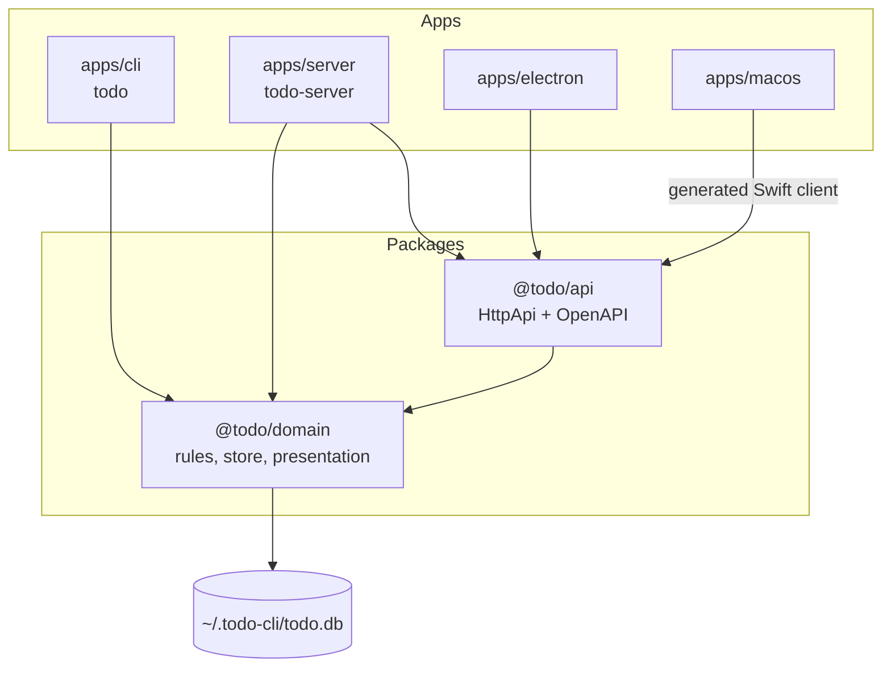
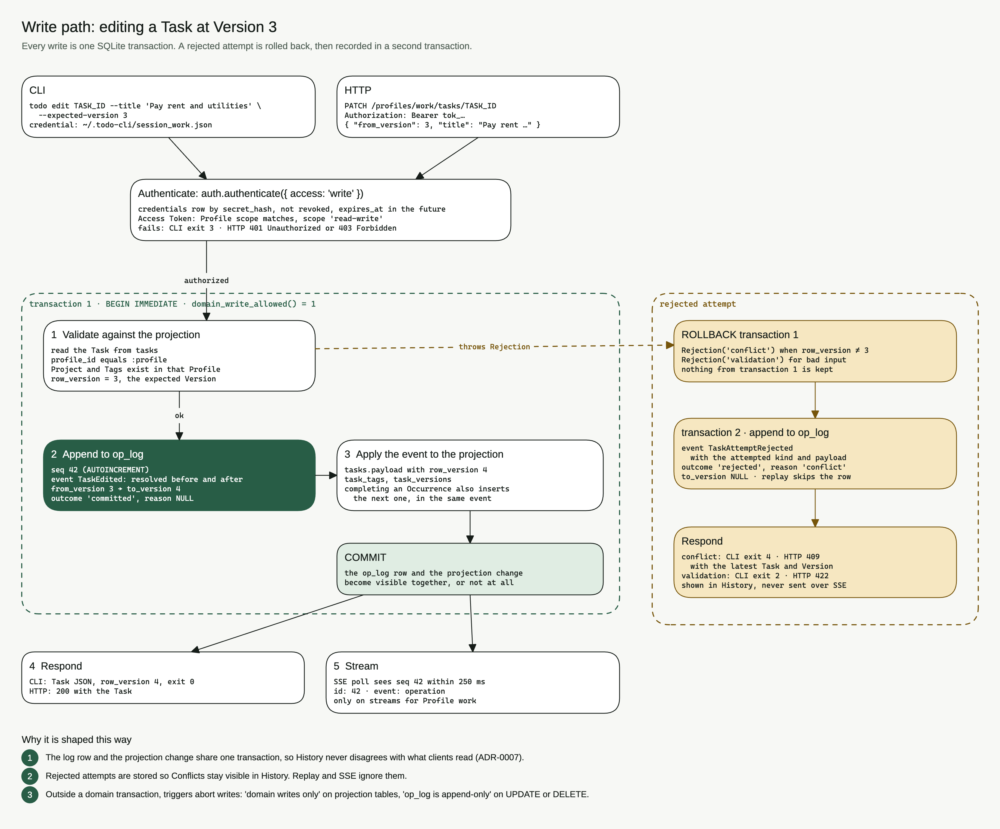
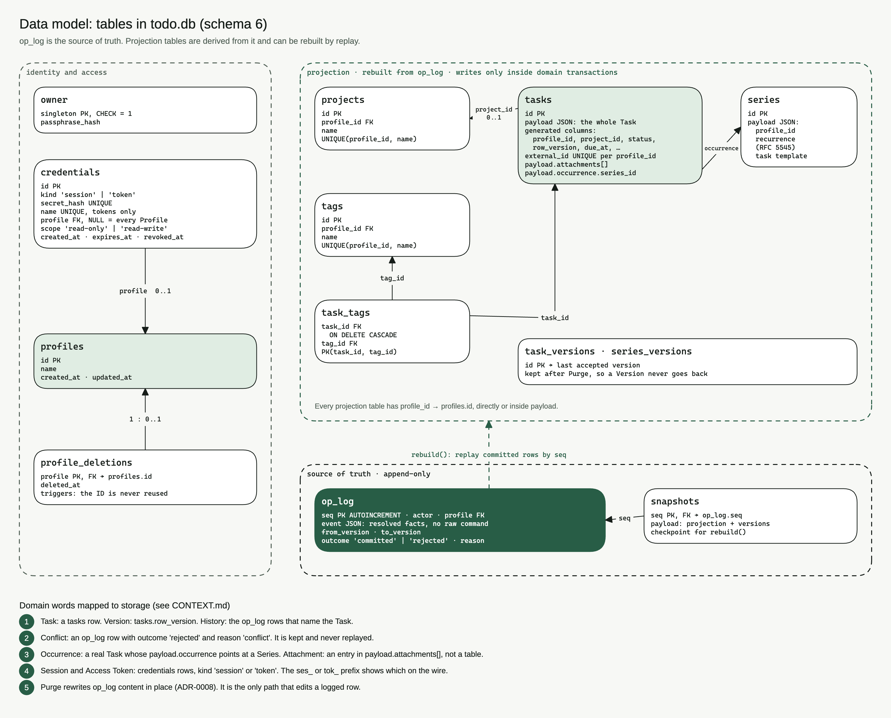
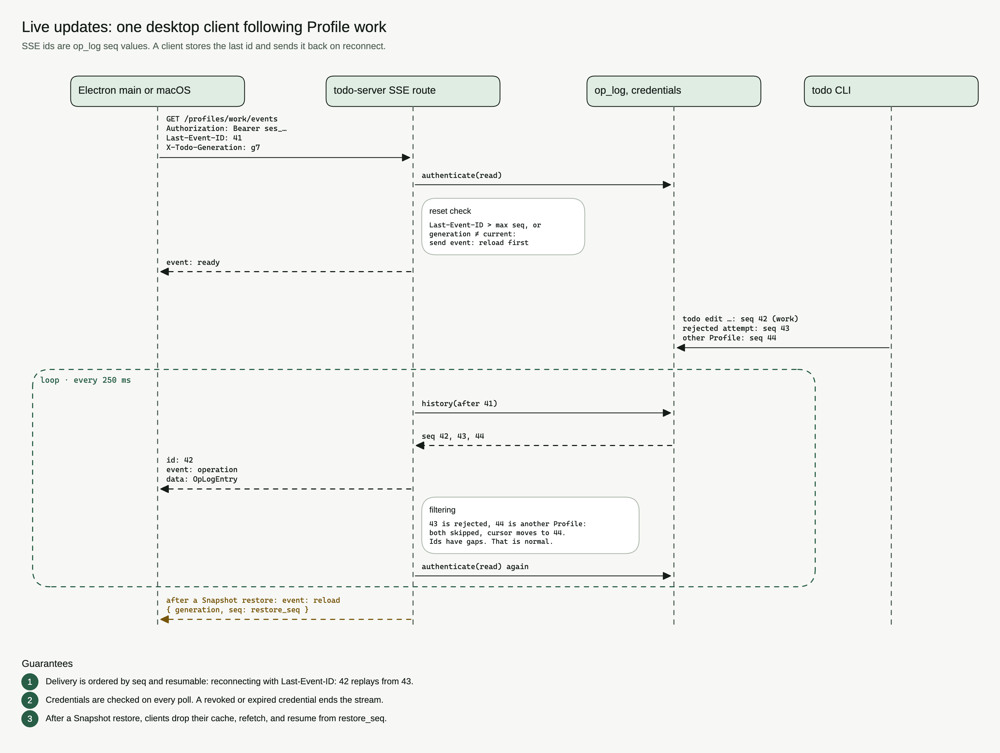

# Architecture

Todo is a local-first Task tracker for one person. Agents and several clients
read and write the same database. Domain terms are defined in
[CONTEXT.md](../CONTEXT.md). Binding choices live in [the decision log](adr/README.md).

## Runtime

The CLI talks to `@todo/domain` and opens SQLite itself, so it works with the
server stopped. Electron and macOS never open the database. They call the local
HttpApi and subscribe to SSE. The server is a loopback gateway that runs the
same domain package.


`@todo/domain` is the only writer. Guard triggers reject direct edits to
projection tables. That is [ADR-0001](adr/0001-port-to-effect-with-shared-domain.md)
and [ADR-0007](adr/0007-operation-log-is-the-source-of-truth.md). Desktop clients
stay on HTTP because a Swift copy of the rules would drift, which is
[ADR-0002](adr/0002-server-is-the-gateway-for-ui-and-remote-clients.md).

## Packages



| Path | Role |
| --- | --- |
| `packages/domain` | Schemas, commands, recurrence, operation store, rendering |
| `packages/api` | Effect HttpApi. Electron imports it. `/openapi.json` feeds the Swift client |
| `apps/cli` | `@effect/cli`. Compiles to `todo` |
| `apps/server` | Loopback HttpApi, SSE, scheduler, launchd lifecycle. Compiles to `todo-server` |
| `apps/electron` | Desktop UI. Session stays in the main process |
| `apps/macos` | SwiftUI UI. Session stays in Keychain |

The monorepo uses pnpm workspaces. Bun runs TypeScript and compiles the two binaries.
The contract for HTTP is one HttpApi definition
([ADR-0003](adr/0003-httpapi-openapi-as-the-single-contract.md)). Electron uses
that TypeScript API. macOS uses a Swift client generated from the OpenAPI
document. There is no second protocol.

Every capability ships an agent command and a human UI
([ADR-0009](adr/0009-every-capability-is-native-to-agents-and-humans.md)). A
feature that exists in only one of those is unfinished.

## Writes

A command from the CLI or HttpApi first authenticates its credential. It then
runs in one `BEGIN IMMEDIATE` transaction that validates against the
projection, including the Version check, appends a resolved event to `op_log`,
and updates the projection tables. SSE publishes the committed `seq`. Clients
resume with `Last-Event-ID`.

A Conflict or validation failure rolls back that transaction, then records a
rejected attempt in its own short transaction. Rejected rows stay in History.
Replay never applies them.



Events store resolved facts, not raw commands. Replay does not read the clock
or expand an RRULE. `rebuild()` can start from the newest row in the internal
`snapshots` table and replay only the tail. Owner-facing
Snapshots are separate copies of the whole database, described in
[ADR-0012](adr/0012-owner-snapshots.md).

## Data

The database belongs to one owner. Tasks live in a Profile such as work or
personal. A Project groups Tasks inside a Profile. A Tag cuts across Projects.



A Session is a fixed seven-day sign-in. An Access Token is named, optional
Profile-scoped, and revocable. Both travel as `Authorization: Bearer`. Prefixes
`ses_` and `tok_` tell them apart. See
[ADR-0005](adr/0005-single-owner-profiles-and-two-credential-kinds.md).

A Task carries a Version. Writes send the Version they read. A mismatch is a
Conflict, exit 4 on the CLI and HTTP 409 on the server. Delete hides a Task.
Purge erases it and redacts History content
([ADR-0008](adr/0008-purge-redacts-history-content.md)). Revert appends the
opposite change. The original entry stays.

A Series holds an RFC 5545 rule. An Occurrence is a real Task. Completing or
cancelling one creates the next Occurrence in the same transaction, which is
why recurrence works from the CLI with the server down
([ADR-0006](adr/0006-time-model-and-rfc5545-recurrence.md)).

## Live updates



`GET /profiles/:profile/events` is `text/event-stream`. A `ready` event has no
id. Each later `operation` event is a committed `OpLogEntry`, with `seq` as the
SSE id. Only that Profile's committed operations appear, so gaps in ids are
normal: rejected attempts and other Profiles are skipped.

The route rereads `op_log` every 250 ms and checks the credential on each pass.
That is how a `todo edit` from the CLI process reaches an open desktop app.
There is no file watcher and no IPC between the two processes. Reconnect with
`Last-Event-ID: <seq>` to resume after that id, and save cursors per Profile.
After a Snapshot restore the generation changes, and the stream sends `reload`
with the generation and `restore_seq`.

The scheduler lives in the server process. It fires reminders for due instants,
wakes snoozed Tasks, and deletes expired credentials. Each pass rereads SQLite,
so a restart does not lose work. ReminderFired operations do not advance Task
Version. Date-only planning values do not fire reminders.

## Diagrams

All four drawings are frames in one Excalidraw scene,
[diagrams/todo.excalidraw](diagrams/todo.excalidraw). Open it at
excalidraw.com to explore or edit. The scene is generated by
[diagrams/generate.mjs](diagrams/generate.mjs), and its labels name real
tables, columns, routes and pragmas. When one of those changes in code, change
the label in the generator and render again:

```sh
docs/diagrams/render.sh
```

The script rewrites the scene and exports each frame (`runtime`, `write`,
`model`, `live`) to a PNG with `excalidraw render --frame-id`. It needs a local
Chrome, Chromium, Edge, or Firefox. It does not need an Excalidraw account.
Colors follow `design/electron/TOKENS.md`.
