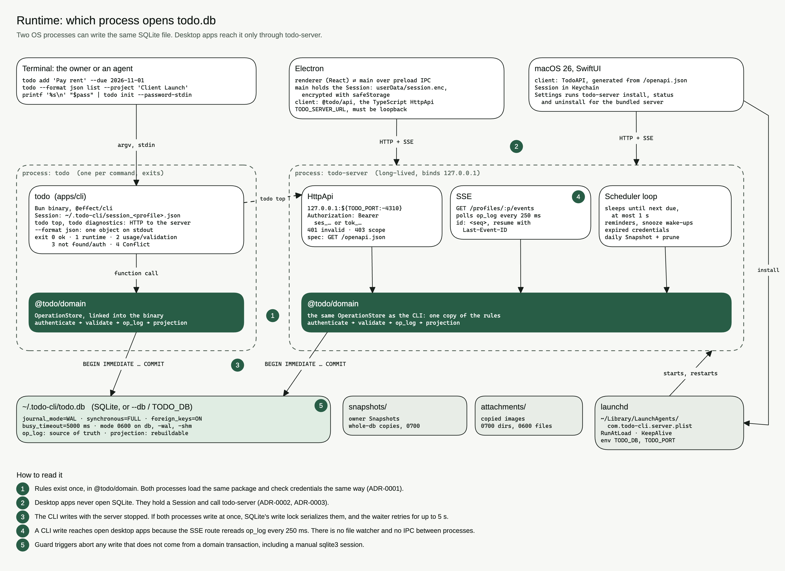
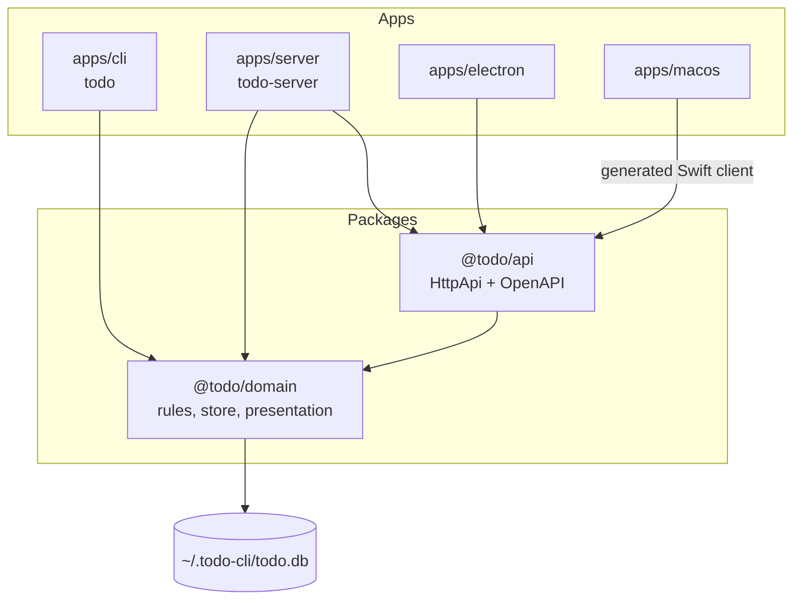
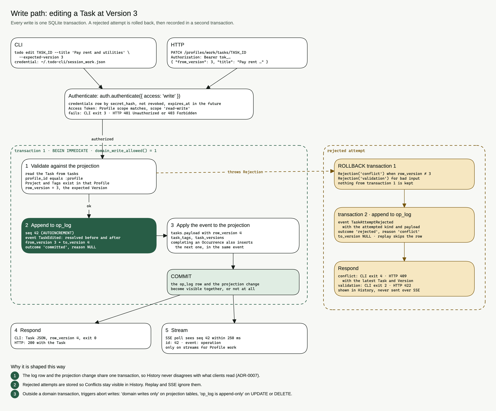
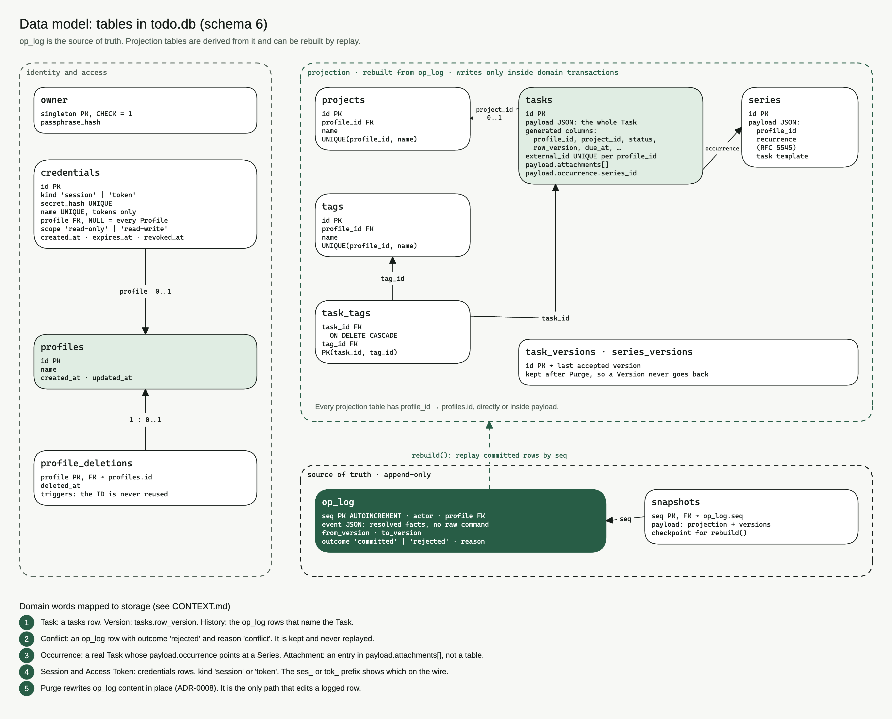
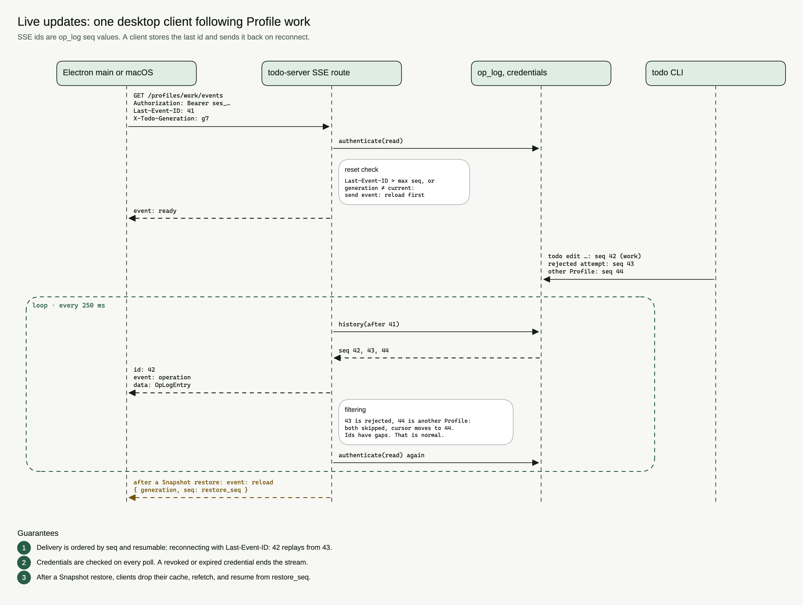

# Architecture

Todo is a local-first Task tracker for one person. Agents and several clients
read and write the same database. Domain terms are defined in
[CONTEXT.md](../CONTEXT.md). Binding choices live in [the decision log](adr/README.md).

## Runtime

The CLI talks to `@todo/domain` and opens SQLite itself, so it works with the
server stopped. Electron and macOS never open the database. They call the local
HttpApi and subscribe to SSE. The server is a loopback gateway that runs the
same domain package.



`@todo/domain` is the only writer. Guard triggers reject direct edits to
projection tables. That is [ADR-0001](adr/0001-port-to-effect-with-shared-domain.md)
and [ADR-0007](adr/0007-operation-log-is-the-source-of-truth.md). Desktop clients
stay on HTTP because a Swift copy of the rules would drift, which is
[ADR-0002](adr/0002-server-is-the-gateway-for-ui-and-remote-clients.md).

## Packages



| Path | Role |
| --- | --- |
| `packages/domain` | Schemas, commands, recurrence, operation store, rendering |
| `packages/api` | Effect HttpApi. Electron imports it. `/openapi.json` feeds the Swift client |
| `apps/cli` | `@effect/cli`. Compiles to `todo` |
| `apps/server` | Loopback HttpApi, SSE, scheduler, launchd lifecycle. Compiles to `todo-server` |
| `apps/electron` | Desktop UI. Session stays in the main process |
| `apps/macos` | SwiftUI UI. Session stays in Keychain |

The monorepo uses pnpm workspaces. Bun runs TypeScript and compiles the two binaries.
The contract for HTTP is one HttpApi definition
([ADR-0003](adr/0003-httpapi-openapi-as-the-single-contract.md)). Electron uses
that TypeScript API. macOS uses a Swift client generated from the OpenAPI
document. There is no second protocol.

Every capability ships an agent command and a human UI
([ADR-0009](adr/0009-every-capability-is-native-to-agents-and-humans.md)). A
feature that exists in only one of those is unfinished.

## Writes

A command from the CLI or HttpApi first authenticates its credential. It then
runs in one `BEGIN IMMEDIATE` transaction that validates against the
projection, including the Version check, appends a resolved event to `op_log`,
and updates the projection tables. SSE publishes the committed `seq`. Clients
resume with `Last-Event-ID`.

A Conflict or validation failure rolls back that transaction, then records a
rejected attempt in its own short transaction. Rejected rows stay in History.
Replay never applies them. A rejected input over 32,768 characters of JSON is
stored only as its size, and a repeated auth denial is stored once per
minute (ADR-0007 amendment).



Events store resolved facts, not raw commands. Replay does not read the clock
or expand an RRULE. `rebuild()` can start from the newest row in the internal
`snapshots` table and replay only the tail. Owner-facing
Snapshots are separate copies of the whole database, described in
[ADR-0012](adr/0012-owner-snapshots.md).

## Data

The database belongs to one owner. Tasks live in a Profile such as work or
personal. A Project groups Tasks inside a Profile. A Tag cuts across Projects.



A Session is a fixed seven-day sign-in. An Access Token is named, optional
Profile-scoped, and revocable. Both travel as `Authorization: Bearer`. Prefixes
`ses_` and `tok_` tell them apart. See
[ADR-0005](adr/0005-single-owner-profiles-and-two-credential-kinds.md).

A Task carries a Version. Writes send the Version they read. A mismatch is a
Conflict, exit 4 on the CLI and HTTP 409 on the server. Delete hides a Task.
Purge erases it and redacts History content
([ADR-0008](adr/0008-purge-redacts-history-content.md)). Revert appends the
opposite change. The original entry stays.

A Series holds an RFC 5545 rule. An Occurrence is a real Task. Completing or
cancelling one creates the next Occurrence in the same transaction, which is
why recurrence works from the CLI with the server down
([ADR-0006](adr/0006-time-model-and-rfc5545-recurrence.md)).

## Task search

`packages/domain/src/task-search.ts` parses and evaluates title and description
queries once per Task. `filterTaskRecords` combines search and literal id-prefix
filtering with the existing filters without changing their order. The matcher
uses a pinned Unicode default full-fold table and returns original UTF-16 word
spans together with acceptance. `TaskRead` and `TaskViewSchema` carry optional
`search_matches` in read responses only. Stored Tasks and events have no search
metadata. CLI JSON and HTTP list results carry the same matched strings and
spans; clients highlight those spans without repeating matching. No migration
or FTS index is needed. See [ADR-0014](adr/0014-task-search.md).

Each client retains one applied response snapshot while requesting a newer
identity. Search text survives Profile and view switches. Failed reads offer
Retry and recover on current-Profile SSE reconnection or operations, without
a search retry timer. See [ADR-0015](adr/0015-search-text-retention-and-recovery.md).

## Agent discovery contract

The approved [agent discovery contract](decisions/agent-discovery-phase-0.md)
adds a Profile-to-Project directory and explicit read-only Task prefix lookup
over `Authentication.profiles`. Implementation follows the approved Phase 0 gate.
[ADR-0019](adr/0019-authorized-read-only-discovery.md) records the boundary.
Normal Task lookup and mutations remain Profile-scoped. The workflow
frames are `agent-errors`, `agent-lookup-errors`, `agent-directory`, `agent-prefix`,
and `agent-list` in the shared Excalidraw scene.

## Live updates



`GET /profiles/:profile/events` is `text/event-stream`. A `ready` event has no
id. Each later `operation` event is a committed `OpLogEntry`, with `seq` as the
SSE id. Only that Profile's committed operations appear, so gaps in ids are
normal: rejected attempts and other Profiles are skipped.

The route rereads `op_log` every 250 ms and checks the credential on each pass.
That is how a `todo edit` from the CLI process reaches an open desktop app.
There is no file watcher and no IPC between the two processes. Reconnect with
`Last-Event-ID: <seq>` to resume after that id, and save cursors per Profile.
After a Snapshot restore the generation changes, and the stream sends `reload`
with the generation and `restore_seq`.

The scheduler lives in the server process. It fires reminders for due instants,
wakes snoozed Tasks, and deletes expired credentials. Each pass rereads SQLite,
so a restart does not lose work. ReminderFired operations do not advance Task
Version. Date-only planning values do not fire reminders.

Creation and import accept Attachment reference arrays. Creation validates every
reference before committing the Task. Import can adopt an existing Task by id
and expected Version. Batch Attachment commands commit one Task group at a time,
with attached, unchanged and rejected results. URI storage and these atomicity
rules are defined by [ADR-0013](adr/0013-attachment-uri-and-atomic-inputs.md).

Batch edit accepts explicit Task ids, each Task's expected Version and exactly
one shared field change. The CLI and `POST /profiles/:profile/batch-edit` call
`batchEditTasks`, which composes the existing Task edit command. Each Task
commits independently. A stale Version returns a Conflict row without changing
that Task. Dry run executes against an in-memory store copy, preserving the
source database, History, metadata definitions and Versions. Both desktop
clients keep the loaded selection for preview and apply, then reload the
current Versions explicitly after a Conflict.

## Diagrams

The architecture and proposed Task search workflows are frames in one Excalidraw scene,
[diagrams/todo.excalidraw](diagrams/todo.excalidraw). Open it at
excalidraw.com to explore or edit. The scene is generated by
[diagrams/generate.mjs](diagrams/generate.mjs), and its labels name real
tables, columns, routes and pragmas. When one of those changes in code, change
the label in the generator and render again:

```sh
docs/diagrams/render.sh
```

The script rewrites the scene and exports each frame (`runtime`, `write`,
`model`, `live`, `search-cli`, `search-http`, `search-electron`, `search-swift`,
`search-copy`, `search-electron-filters`, `search-swift-filters`) to a PNG with `excalidraw render --frame-id`. The search design
gate is [Task search Phase 0](decisions/task-search-phase-0.md). It needs a local
Chrome, Chromium, Edge, or Firefox. It does not need an Excalidraw account.
Colors follow `design/electron/TOKENS.md`.
