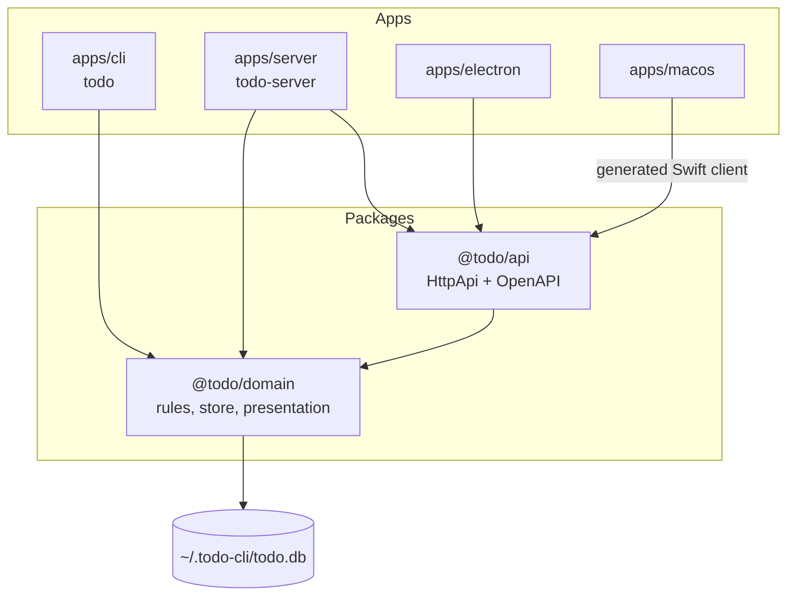

# Architecture

Todo is a local-first Task tracker for one person. Agents and several clients
read and write the same database. Domain terms are defined in
[CONTEXT.md](../CONTEXT.md). Binding choices live in [the decision log](adr/README.md).

## Runtime

The CLI talks to `@todo/domain` and opens SQLite itself, so it works with the
server stopped. Electron and macOS never open the database. They call the local
HttpApi and subscribe to SSE. The server is a loopback gateway that runs the
same domain package.


`@todo/domain` is the only writer. Guard triggers reject direct edits to
projection tables. That is [ADR-0001](adr/0001-port-to-effect-with-shared-domain.md)
and [ADR-0007](adr/0007-operation-log-is-the-source-of-truth.md). Desktop clients
stay on HTTP because a Swift copy of the rules would drift, which is
[ADR-0002](adr/0002-server-is-the-gateway-for-ui-and-remote-clients.md).

## Packages



| Path | Role |
| --- | --- |
| `packages/domain` | Schemas, commands, recurrence, operation store, rendering |
| `packages/api` | Effect HttpApi. Electron imports it. `/openapi.json` feeds the Swift client |
| `apps/cli` | `@effect/cli`. Compiles to `todo` |
| `apps/server` | Loopback HttpApi, SSE, scheduler, launchd lifecycle. Compiles to `todo-server` |
| `apps/electron` | Desktop UI. Session stays in the main process |
| `apps/macos` | SwiftUI UI. Session stays in Keychain |

The monorepo uses pnpm workspaces. Bun runs TypeScript and compiles the two binaries.
The contract for HTTP is one HttpApi definition
([ADR-0003](adr/0003-httpapi-openapi-as-the-single-contract.md)). Electron uses
that TypeScript API. macOS uses a Swift client generated from the OpenAPI
document. There is no second protocol.

Every capability ships an agent command and a human UI
([ADR-0009](adr/0009-every-capability-is-native-to-agents-and-humans.md)). A
feature that exists in only one of those is unfinished.

## Writes

A command from the CLI or HttpApi first authenticates its credential. It then
runs in one `BEGIN IMMEDIATE` transaction that validates against the
projection, including the Version check, appends a resolved event to `op_log`,
and updates the projection tables. SSE publishes the committed `seq`. Clients
resume with `Last-Event-ID`.

A Conflict or validation failure rolls back that transaction, then records a
rejected attempt in its own short transaction. Rejected rows stay in History.
Replay never applies them. A rejected input over 32,768 characters of JSON is
stored only as its size, and a repeated auth denial is stored once per
minute, decided from History: first in a read, and on absence again inside
the write transaction that appends (ADR-0007 amendment). The
look-back walks that Profile by descending sequence to the start of the preceding
minute. A sufficiently late commit with an older recording clock can hide a
matching refusal and permit another row. Missing, future and non-recording stamps
never end the walk. The [timestamp audit](decisions/ui-speed/durable-denial.md)
records the provenance and the explicit ordering limit.


Events store resolved facts, not raw commands. Replay does not read the clock
or expand an RRULE. `rebuild()` can start from the newest row in the internal
`snapshots` table and replay only the tail. Owner-facing
Snapshots are separate copies of the whole database, described in
[ADR-0012](adr/0012-owner-snapshots.md). Purge redaction deletes materialized
Task references discovered through SQLite foreign keys before deleting the Task.
It also repairs orphan references when the Task is already absent. Snapshot
copies retain pending Attachment erasure jobs. Restore combines saved and live
jobs, retaining only ids in the durable Purge union, so a restored Deleted Task
keeps its bytes. The restore pass erases eligible copied bytes after commit, before returning.
Failures retain jobs for retry without changing restore success.
Preview stores share the Attachment root but never drain cleanup jobs, either
during construction or after a simulated write. Their Purge state cannot
authorize erasure under the persistent store's root. Unchanged copy redaction
skips compaction, keeping its checksum stable. Content-free History and
Version tombstones remain. The [reference inventory](../.agents/skills/verify-snapshots/features/task-references.md)
records declared and JSON references and their verification.

## Data

The database belongs to one owner. Tasks live in a Profile such as work or
personal. A Project groups Tasks inside a Profile. A Tag cuts across Projects.


A Session is a fixed seven-day sign-in. An Access Token is named, optional
Profile-scoped, and revocable. Both travel as `Authorization: Bearer`. Prefixes
`ses_` and `tok_` tell them apart. See
[ADR-0005](adr/0005-single-owner-profiles-and-two-credential-kinds.md).

A Task carries a Version. Writes send the Version they read. A mismatch is a
Conflict, exit 4 on the CLI and HTTP 409 on the server. Delete hides a Task.
Purge erases it and redacts History content
([ADR-0008](adr/0008-purge-redacts-history-content.md)). Revert appends the
opposite change. The original entry stays.

A Series holds an RFC 5545 rule. An Occurrence is a real Task. Completing or
cancelling one creates the next Occurrence in the same transaction, which is
why recurrence works from the CLI with the server down
([ADR-0006](adr/0006-time-model-and-rfc5545-recurrence.md)).

## Task search

`packages/domain/src/task-search.ts` parses and evaluates title and description
queries once per Task. `filterTaskRecords` combines search and literal id-prefix
filtering with the existing filters without changing their order. The matcher
uses a pinned Unicode default full-fold table and returns original UTF-16 word
spans together with acceptance. `TaskRead` and `TaskViewSchema` carry optional
`search_matches` in read responses only. Stored Tasks and events have no search
metadata. CLI JSON and HTTP list results carry the same matched strings and
spans; clients highlight those spans without repeating matching. No migration
or FTS index is needed. See [ADR-0014](adr/0014-task-search.md).

Query changes read the filtered Task list and the current planning view concurrently.
Full refreshes also load the unfiltered catalog, discovery and all view counts.
Both clients guard all publication after every required read finishes.
Full requests mark the catalog owed before reads. A query promotes to full while
that obligation remains, including after a failed or superseded full refresh.
Only a guarded full publication clears it. Startup, accepted writes, current-Profile
SSE/reconnect, selection resets and Snapshot reload keep full catalog coverage.

Normalized duplicate clauses execute once. Word clauses memoize acceptance for
each distinct folded word within one field evaluation and retain every original
occurrence for spans. Typo prefixes use a reusable banded unrestricted Damerau
buffer. The CLI and the server share one generator core. Both drain it through
`filterTaskRecordsEffect`, yielding between Tasks and after
512 evaluated word occurrences. `TaskCommands.list` starts that drain after
`auth.read` has returned its authorized in-memory view, with no SQLite read
transaction open. Field preparation uses the same generator, yielding after
512 graphemes or segmented parts while preserving normalization across chunks.
Client disconnect interrupts the HTTP fiber at a checkpoint through the Bun
HTTP adapter's request abort listener.

Each OperationStore owns a bounded TaskSearchCache keyed by Profile and exact
field text. It retains complete PreparedFields across requests; a hit returns
the words and preparation count without refolding or preparation yields. Query
results and empty-clause work are not cached. The LRU retains at most 4,096
entries. Retained entries and up to 4,096 current pending slots share a 16 MiB
charged budget; a completed entry over 4 MiB computes without retention. Charges
include exact keys, Profile strings, containers and Words. These accounting
bounds exclude transient preparation buffers, superseded invocation-local tokens,
allocator overhead and separately reported per-Profile generation metadata;
they are not RSS limits. V3's expanding 100,000-character field is not retained.

A read captures the cache-wide epoch and its Profile's cache-local purge
generation before authorization and the SQLite Task read. A miss registers a
fresh ownership token, yields during preparation and admits only while its token,
epoch and generation remain current. Later misses supersede earlier tokens;
interruption or failure removes only the invocation's own current token.

Every Purge clears the whole memo and advances its epoch inside the transaction.
This erases moved Tasks' earlier Profile keys and fences in-flight reads even
before they register a pending slot. Snapshot restore also clears and fences the
memo before returning. Local Profile deletion advances that Profile's generation
and evicts its entries and pending slots. Rollback can lose retention only.
Close empties all cache state and permanently fences admission.

Before serving HTTP, the server captures the current operation sequence. Its
250 ms hygiene observer reads only new committed seq/kind/original_kind fields.
The domain owns that SQL query. Restore metadata uses the existing Profile/seq
index with canonical NULL Profile and snapshot-restore actor headers before JSON
extraction. Task payloads are not decoded by the observer. A committed
TaskHistoryRedacted row with original_kind TaskPurged, a TaskPurged row or a
ProfileDeleted row clears the whole memo. A Snapshot generation change clears it
and resets the cursor to the current maximum, including a Purge at a reused
sequence before the next poll. Compiled CLI/server proofs require eviction within
1000 ms, including CLI startup. The observer can clear again after this server's
own Purge; that harmless extra refill is deliberate. A Purge is rare owner work,
and the next search pays one uncached refill. External Profile deletion also
clears all Profiles. This is memory hygiene, not database coherence for matching.
Exact current text keys preserve search results after other writers and restore.

`PreparedField` carries words and the exact folded UTF-16 field length.
Search charges that length after each field is ready, including supplied stored
PreparedFields, and charges evaluated Damerau cells plus walked word occurrences
and tested phrase start positions with one shared rational
weight. The request meter spans Tasks that pass the other TaskFilters and checks
at checkpoints and before publication. A refusal returns `search_too_broad`,
CLI exit 2 or HTTP 422, with no partial rows. The limits and owner decision are
in the [ADR-0014 budget amendment](adr/0014-task-search.md#search-work-budget-owner-2026-11-09).
The Effect driver closes a suspended generator on interruption or failure.

Each client retains one applied response snapshot while requesting a newer
identity. Search text survives Profile and view switches. Failed reads offer
Retry and recover on current-Profile SSE reconnection or operations, without
a search retry timer. See [ADR-0015](adr/0015-search-text-retention-and-recovery.md).

## Agent discovery contract

HTTP Task reads load Profile-filtered projection rows. Task lists authenticate
and materialize metadata, Tasks and Dependencies in one checked SQLite callback.
Search CPU work and response encoding run afterward on owned rows and selectors.
Planning views use a Profile catalog without History or Series.
Project and Tag counts use grouped projection queries. Profile counts use one
grouped query for the credential's authorized, active Profiles inside the existing
immediate authorization transaction. Directory counts share its existing deferred
read snapshot. Projection guards, generated Task columns, Version validation and
atomic event/projection writes remain authoritative. Reads do not replay the log.

Credential checks create read authorities inside the authentication module.
Profile, scope, parsed fields and database identity live in ECMAScript private
fields. Query ports validate the genuine instance, exact prototype, authority
kind, database, live transaction lease, failed-scope ancestry, expiry and the
credential check's write serial before SQL or image access. The outer checked
callback's finally closes the lease before native COMMIT and transaction-exit
cleanup. A final fallback handles failed admission. Rollback, interruption and
failure also close it. Failed nested scopes invalidate their
values without ending Discovery's outer snapshot. A later checked scope verifies
credentials again and requires the original restore generation. Copies,
subclasses, mutation and retained values cannot grant access; refusal uses the
existing generic storage error. The authority, its payload and its
class/prototype are frozen. Ordinary readers return data and plain selectors.

One classifier runs in the credential-check snapshot after credential and scope
validation. It distinguishes active, tombstoned and never-created identifiers.
Only an active Profile receives a query authority. Never-created results contain
no Profile id or authority and use literals for empty replies; Quick-add parses
its supplied text without looking up Tags or Projects. Their credential lookup
and classification are the only statements. CLI name resolution selects the
active id after name reuse; a deleted HTTP id remains unavailable.

Diagnostics materializes generation, Snapshot manifests, pending reminders and
metrics inside a checked owner callback under the existing IMMEDIATE transaction.
This holds the writer lock longer while total read time remains unchanged.
Paired owner-shaped measurements give continuous hold medians of 3.59 ms before
and 25.34 ms after; the retained-Snapshot fixture gives 3.67 ms and 31.39 ms.
The coordinator accepted this cost for this unit. A separate writer waits until
the read returns, then commits. A deferred owner read scope and cheaper metrics
queries remain proposals for a later unit. Snapshot write helpers continue to
use requireOwner under the write path's rules.

Task History selects relevant event rows in SQL before decoding OpLogEntry.
SSE catch-up selects only committed rows for its Profile and cursor. Full History
reads remain available to commands that need them, Revert, replay and recovery.
The ordinary HTTP authorization transaction remains immediate. No transaction
mode changes accompany these projection queries.

The approved [agent discovery contract](decisions/agent-discovery-phase-0.md)
adds a Profile-to-Project directory and explicit read-only Task prefix lookup.
`Discovery.directory` and `Discovery.lookup` call the existing authentication
queries inside `Authentication.readSnapshot`, one synchronous deferred SQLite
transaction. The Profile visibility predicate remains in Authentication. Each
Profile read rechecks the credential; any failure discards the aggregate before
rejected-auth History is recorded in its separate transaction. A concurrent WAL
writer cannot mix database states in a response. Deletions or revocations
committed after that snapshot are observed on the next request. No discovery
cache, migration, event, or persistent write is added.
[ADR-0019](adr/0019-authorized-read-only-discovery.md) records the boundary.
Normal Task lookup and mutations remain Profile-scoped. The workflow
frames are `agent-errors`, `agent-lookup-errors`, `agent-directory`, `agent-prefix`,
and `agent-list` in the shared Excalidraw scene.

`exit-status.ts` owns the process exit pair and its constrained schema. HTTP
errors keep their tags and statuses and add the equivalent pair. Request decoding
uses the API-wide RequestDecoding middleware, while ValidationHistory keeps
authenticated rejection recording for Task mutations. `task-lookup-error.ts`
reads the selected Profile through Authentication before formatting recovery.
The CLI enriches missing Task errors while its store is open. Normal History
reads, exact-id selection and mutation authorization retain their existing rules.
ListResponse requires tasks, including an empty array. Export and Review retain
TasksResponse and their original output.

## Live updates


`GET /profiles/:profile/events` is `text/event-stream`. A `ready` event has no
id. Each later `operation` event is a committed `OpLogEntry`, with `seq` as the
SSE id. Only that Profile's committed operations appear, so gaps in ids are
normal: rejected attempts and other Profiles are skipped.

The route waits at most 250 ms before rereading `op_log` and checking the
credential on each pass.
Each poll checks and materializes in one transaction and retains plain
subscription selectors between polls. A never-created identifier is classified
again on every poll, so a later CLI creation starts normal ordered delivery.
For a still-valid credential, a changed restore generation is announced with
`reload` before the restored Profile's outcome. This includes a restored
tombstone: reload advances the cursor to the DatabaseRestored boundary, then a
fresh pass sends the existing not_found failure and closes. The reload result
contains generation metadata and grants no read authority.
An already connected, still-valid unscoped credential (a Session or Access Token)
has a private one-shot terminal permission through the committed `ProfileDeleted`
sequence, followed by the existing failure and close sequence. Revoked or expired
credentials receive no terminal batch. A deletion-revoked scoped Token closes as
revoked. The base's
terminal batch for revoked or expired credentials is intentionally removed under
the owner's ruling.
The compiled frame comparison covers ordering, gaps, reconnect, restore,
revocation, expiry and deletion. A valid Session or unscoped Token keeps the same
final TaskCreated, two TaskDeleted and ProfileDeleted frames, then the same
not_found failure and close. A deletion-revoked scoped Token, an already revoked
Session or Token, and an expired Session or Token receive only ready followed by
their unchanged Unauthorized revoked or expired failure
and close. The base also sent the terminal operation batch to these credentials.
The exact raw frames and sequence ids are recorded in the server-reads report.
A server-owned `StreamWake` also wakes every open stream
after an in-process write. `stream-wake-store.ts` decorates the server's store,
Authentication, Snapshots and ScheduledWork at their public boundaries. Exhaustive
policies require a read/write choice when a public member is added. Empty scheduler
work does not signal; SSE and cache hygiene use the raw store. The domain transaction
and projection code are unchanged. A stream remembers the wake revision from before
its pass, so commits during a pass force the next wait to return immediately.
Bursts collapse into one pending pass per stream, and cancellation removes waiters.
All decorated member exits, including reads and synchronous calls, check the
connection's native SQLite transaction state. Writes mark a pending notification;
the first exit outside a transaction delivers it. Nested writes cannot signal
before the outer transaction ends, and detached children signal their own commits.
The adapter obtains the existing connection once without changing domain code.
Observer defects cannot change a write's result or cause; the timer remains its fallback.
The wake decides only when a pass starts. The revision is read right after the
wait and before the pass's checked lease, and is carried through the reload,
ordinary and terminal results. Every pass still opens a fresh checked lease, and
no lease or authority is held across the wait. The generation check, History
cursor, authorization, terminal permission and emitted events are those above.
The raw store reaches only those two readers, typed as `StreamReads` and
`CacheHygieneReads` so neither can build a writer, and a server test forbids the
private connection, SQL transaction control and any other raw-store use in the
server. Every transaction callback is synchronous, which the decorator and the
loop rely on. One commit goes unsignalled: `signIn` verifies the passphrase on a
promise outside its fiber, so an interrupted sign-in (for example, a client that
disconnects) exits and signals first, and its decision then commits one
Profile-less auth row (`AuthChanged` for a new Session, or
`AuthAttemptRejected`) with no signal. No stream delivers it: streams deliver only
committed rows of their own Profile, and the next pass moves past it. The domain
is unchanged for it.
That is how a `todo edit` from the CLI process reaches an open desktop app.
There is no file watcher and no IPC between the two processes. Reconnect with
`Last-Event-ID: <seq>` to resume after that id, and save cursors per Profile.
After a Snapshot restore the generation changes, and the stream sends `reload`
with the generation and `restore_seq`.

The scheduler lives in the server process. It fires reminders for due instants,
wakes snoozed Tasks, and deletes expired credentials. Each pass rereads SQLite,
so a restart does not lose work. ReminderFired operations do not advance Task
Version. Date-only planning values do not fire reminders.

Creation and import accept Attachment reference arrays. Creation validates every
reference before committing the Task. Import can adopt an existing Task by id
and expected Version. Batch Attachment commands commit one Task group at a time,
with attached, unchanged and rejected results. URI storage and these atomicity
rules are defined by [ADR-0013](adr/0013-attachment-uri-and-atomic-inputs.md).

Batch edit accepts explicit Task ids, each Task's expected Version and exactly
one shared field change. The CLI and `POST /profiles/:profile/batch-edit` call
`batchEditTasks`, which composes the existing Task edit command. Each Task
commits independently. A stale Version returns a Conflict row without changing
that Task. Dry run executes against an in-memory store copy, preserving the
source database, History, metadata definitions and Versions. Both desktop
clients keep the loaded selection for preview and apply, then reload the
current Versions explicitly after a Conflict.

## Diagrams

The architecture and proposed Task search workflows are frames in one Excalidraw scene,
`diagrams/todo.excalidraw`. The scene is generated by
[diagrams/generate.mjs](diagrams/generate.mjs) and is not tracked in Git: run
`bun docs/diagrams/generate.mjs` to write it locally, then open it at
excalidraw.com to explore. Its labels name real
tables, columns, routes and pragmas. When one of those changes in code, change
the label in the generator and render again:

```sh
docs/diagrams/render.sh
```

The script rewrites the scene and exports each frame (`runtime`, `write`,
`model`, `live`, `search-cli`, `search-http`, `search-electron`, `search-swift`,
`search-copy`, `search-electron-filters`, `search-swift-filters`) to a PNG with `excalidraw render --frame-id`. The search design
gate is [Task search Phase 0](decisions/task-search-phase-0.md). It needs a local
Chrome, Chromium, Edge, or Firefox. It does not need an Excalidraw account.
Colors follow `design/electron/TOKENS.md`.

The proposed Task dependency workflows are also frames in the scene, with
`dag-` prefixes for CLI edge edits, Delete, status refusals, and each client's
picker, list drag, Delete dialog, and graph view. The coordinator approved [Task DAG Phase 0](decisions/task-dag-phase-0.md)
with corrections G1 through G10. ADRs 0016 through 0018 are accepted; their
runtime implementation and verification follow in units A, F, B, E and S.

## Task Dependencies

Tasks and direct Dependency edges are independent facts. Migration 0007 creates
task_dependencies with composite same-Profile endpoint foreign keys, a primary
key by Profile/dependent/blocker and a reverse covering index. Projection schema
recreation creates DDL without changing user_version. Only migrate advances it.
Compact edge events and grouped lifecycle v2 deltas replay through the operation
store; existing v1 events and checkpoints without edges remain readable.

The authoritative dependency-rules and store/dependency-validation modules own
endpoint, cycle, degree and lifecycle guards inside BEGIN IMMEDIATE. Public
commands authenticate and validate visible endpoints before no-op detection.
A no-op writes no History or Version even when its valid expected Version is
stale. A real change CASes only the dependent. Captured full DependencyError
responses survive rollback; History retains the bounded copy.

OperationStore.graph(Profile) reads Tasks and edges in one SQLite read
transaction. graph-model builds temporary adjacency; graph-order uses a Kahn
min-heap over the whole Profile before filters; graph-energy uses temporary
ancestor bitsets and weight masks for distinct pruned sums. graph-queries owns
components, Ready/Blocked, strict ancestry, depth and shape/orientation.
graph-mermaid formats typed identities and escaped labels without a renderer.
TaskRead/TaskView carry optional response metadata, and TaskWrite names additive
write reports. None changes stored Task content. Optional graph metadata stays
omitted on default reads of Profiles with no edges, preserving legacy payloads;
explicit graph filters and ordering still compute the complete result.

The CLI and HttpApi share Dependency commands, initial creation, public Revert,
and Delete fingerprint checks. Batch edge edits commit per item; previews use
an authenticated in-memory fork without source History or Snapshot changes.
TTY md Delete prompts show both directions, default No, and submit the reviewed
fingerprint. JSON and non-TTY requests use explicit confirmation. Client feature
UI and renderer integration remain later units under ADR-0009.

import-dependencies plans external-id references over the proposed Profile graph,
including later file rows. Import applies in dependency order and reports in
file order. Each Task resolves successful mappings again under its writer lock;
failure rolls back that Task's payload, edges and History. Import errors preserve
current_version and an optional complete nested dependency_error.
Export reads one consistent graph snapshot and emits depends_on only when
nonempty. Obsidian keeps one managed note with stable Task blocks, same-note
wiki links and pure Mermaid formatting. GraphNode.mermaid_id maps diagram nodes
to full Task identity without relying on labels or diagram parsing.

Under approved G11, GraphNode carries only mermaid_id, task, in_degree,
out_degree, ready, blocked, depth and remaining_energy. GraphReport carries
strict ancestors, strict descendants and lightest_next for its requested Task
only. Ancestors and descendants use whole-Profile topological order. lightest_next
contains Ready members of the remaining set, including a Ready root, sorted by
own energy ascending, unknown energy last, then whole-Profile topological
position. Query another Task for its sets.
Reachability and Ready-set membership are computed outside node assembly, so
the serialized report has O(n+m) content plus the requested root's sets.
Shared ranking energy and unknown-energy tie behavior are unchanged.

Read authorization owns and validates the request fields before the credential
callback, then returns a frozen nominal read value containing its Profile,
credential scope and parsed fields. Query continuations use that value. Task
lists, Show, graph, History, planning views, Discovery, image reads, owner Snapshot
reads and SSE keep their ids and filters through later callbacks and yields.
Credential secrets are private fields rather than enumerable result properties.
Profile counts consume the checked Profile rows and their ids once; they do not
rediscover a visible set from the credential after checking it.

## Interaction Diagnostics

The shared Diagnostics vocabulary and inventory live in client-diagnostics.ts
and interaction-categories.ts. diagnostic-labels.ts supplies common display
words. diagnostic-context.ts owns bounded scalar spans and an Effect context;
request, command and scheduler boundaries establish roots without changing
business-rule arguments. Server requests accept random recording ids and echo
X-Todo-Request. Owner Session responses add numeric Server-Timing. No diagnostic
record is written to the Task database.

Owner Diagnostics adds one optional versioned profiler object with counters,
fixed histograms, per-stage/category span summaries, a short slow/failed list
and explicit gaps. The default whole body and CLI JSON fit 48 KiB including
pretty formatting. Detailed active/recent spans and stream delivery records
require owner-only detail=true or CLI --detail and fit a separate 64 KiB budget.
Section byte admission and a whole-schema predicate enforce both caps. Metadata
lists are bounded samples with omission counts; aggregate totals remain complete.
Adapter recorder calls use observeDiagnostic. A thrown observation increments
recording_failures and loss counters while the original work continues once.
The guard and shared per-object failure counts live in diagnostic-guard.ts,
which imports neither Node nor Effect. Browser clients use the dedicated
@todo/domain/diagnostic-guard entry. The root package also re-exports it;
diagnostic-context.ts uses the same guard and maps its counts to the existing
profiler fields.
A failed profiler snapshot omits the optional object and preserves the existing
owner Diagnostics body. Recorder failures retain no error text.
A stream delivery joins commit observation to encoded bytes handed to the HTTP
adapter. It does not prove receipt. Bun dispatch before middleware, socket flush,
body completion and the remaining internal attribution stay unobserved. The
[ADR-0020](adr/0020-diagnostics-follow-an-action-to-its-rendered-result.md)
accepts always-on metadata recording in each app and owner-only loopback
ingestion. The private recording store is a sibling diagnostic-recordings
directory beside the configured database, outside todo.db and database Snapshots.
It has 0700 directories, 0600 database/WAL files, 32 MiB per app, seven-day
retention, a 256 MiB total ceiling, 4096 retained batches, a 1 MiB pending queue
and 1024 pending batches. At most 5120 runs exist independently of queue idleness.
The explicit HttpApi profiler group accepts strict 128 KiB / 128-event batches;
run list/show, bounded export pages and comparable-build reports back the CLI
diagnostics runs/show/export/import/compare commands. Import has a dry run;
NDJSON export traverses pages. Client UI/local journal integration and clock
calibration/presentation proof remain later units. Run-local Profile ordinals
and scalar selection/release context contain no Profile identity or Task content.

Recording admission completeness is separate from event retention. Versioned
run.admission metadata and events commit in one transaction. A whole-batch
conflict refusal commits its content-free mark before responding. Marked
summaries withhold all-start fractions and complete comparisons. Exports/imports
carry the mark even without events. Mixed-run event reducers partition action,
clock, crash and gap state by run; clients reducing raw export events preserve
the run admission context.

Recordings now use a separate recordings.db SQLite database, never attached to
the Task database. SQL constraints own run/producer/sequence identity and content
fingerprints. A run, its facts and admission state change atomically. WAL and a
1 ms busy timeout serialize independent server workers; failures give explicit
retain-and-retry results. All recording SQL, private files and reducers run in a
worker thread. The server does bounded decoding and RPC admission only. Startup
and Task work do not await recording recovery. Ordered WAL-snapshot range reads
produce export pages under 128 KiB with their admission mark. Transactional SQL
sums enforce the fixed app/total caps and oldest-first deletion. Fixed-cadence
bounded DELETE sweeps replace file expiry/repair/index machinery. No manifest,
checkpoint, segment file or independent event index remains. See the current
section of [the report](decisions/ui-speed/diag-recordings-report.md).

The recording client bounds all worker RPCs, including reads, to 1024 calls /
1 MiB of encoded requests with an envelope allowance. Readiness and calls expire
after five seconds without retiring a progressing worker. A single dispatched
call and a rate-limited parent queue keep expired queued work off the worker.
Replies and bounded read steps reset a ten-second inactivity watchdog; only
inactivity retires a stalled operation. Recording
creation and unavailable workers retry after one minute while Task service stays
available. Owner Diagnostics includes content-free recording status and failure
counts in its existing error list. Export captures 129 rows per read step; Show
uses 128-row steps, and Compare does not enclose them in a long snapshot. A
concurrent external change makes the read refuse for retry. A pinned external
reader can delay physical expiry within the disk cap; logical retention still
hides old facts. Capacity refusals are counted, maintenance backs off and
recovers automatically. The main file retains its high-water size; no vacuuming
is scheduled.

Recording initialization holds native exclusion on its own file across the
second header/size check and one rollback-journal schema/identifier transaction.
The durable main header publishes ownership before WAL is enabled. Foreign
headers are never opened with SQLite, avoiding changes to their auxiliaries.
An immutable main-catalog check precedes normal validation of a claimed store.
Application id 0x544f4452, version 1 and the exact catalog must match before mode
changes or writes. No old-format migration, validation copy or persistent
lockfile is needed. Exclusion and bounded retry
remain in the recording worker; a compiled control serves Task reads/writes
while that exclusion is held. Rate history stamps each of at most eight samples
per method and expires each on its own 60-second lifetime.

A claimed store's committed catalog, including frames committed only in its
WAL, is read from descriptors before SQLite opens the path, and the writable
connection is validated under a shared exclusion on the store's own descriptor
so that a refusal cannot checkpoint or reset the WAL. That descriptor stays open
for the connection's lifetime. When committed WAL frames exist, the catalog and integrity
checks run on an in-memory image of main plus those frames, never on the files.
Empty main files beside empty sidecars are
initialized as new. Every refusal leaves all files unchanged and is reported in
owner Diagnostics with its state, reason code and the files to remove while the
server is stopped; recordings may be discarded.
